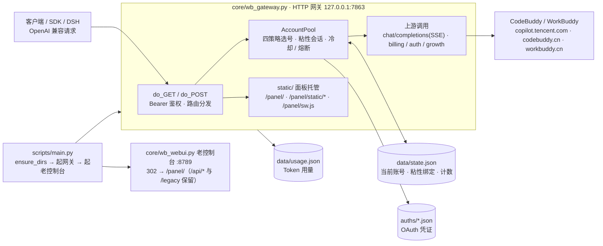

<p align="center">
  
</p>

<h1 align="center">WorkBuddy 统一管理器</h1>

<p align="center">
  <b>把腾讯 WorkBuddy / CodeBuddy 账号变成 OpenAI 兼容 API 的多账号管理网关 · 自研统一面板 + 积分采集器</b><br>
  统一面板（11 视图 · 手机 PWA）· OAuth 设备授权登录 · 账号池四策略 · 熔断与冷却 · 会话粘性 · <b>成长任务一键完成（16/17）</b> · 积分自动采集 · 签到与收益账本 · 实时日志 / 诊断 · 流式 / 非流式
</p>

<p align="center">
  
  
  
  
</p>

<p align="center">
  <a href="./docs/ARCHITECTURE.md">🏛️ 架构与原理</a> · <a href="#项目简介">项目简介</a> · <a href="#核心能力">核心能力</a> · <a href="#-统一面板本项目自研-panel">统一面板</a>
</p>

---

> **本项目是 [Sliverkiss/workbuddy2api](https://github.com/Sliverkiss/workbuddy2api) 的增强分支**（fork）。
> 上游仓库现已删除；本项目**已同步至上游删库前的最后一次更新**（`ea8b1e5`），此后由本分支独立维护演进。
> 在上游设计之上做了 Python 重写 + 自研面板 + 移动端；差异概览见 [与上游的差异](#-与上游的差异)。**注意：上游 Go 版的部分实现（提示词体系、错误码精细分类、出站 UA / 指纹可配、定时调度器、Redis 镜像）在本分支没有移植**，逐项对照见下文。

> ⚠️ **本项目仅限自用账号（签到 / 保活 / 个人工具接入），不支持同时也是禁止批量小号分发额度、二次打包或收费售卖。** 详见 [使用声明（必读）](#使用声明必读)。

## 使用声明（必读）

本项目（含上游 [Sliverkiss/workbuddy2api](https://github.com/Sliverkiss/workbuddy2api)，下同）的开发初衷只有一个：**方便个人管理自己的 WorkBuddy / CodeBuddy 账号**——自动签到、保活、给自己的本地工具提供一个 OpenAI 兼容入口。它是免费、开源、按「原样」提供的个人自用工具。

近期我们发现有人将本项目用于以下行为：

- **批量注册小号 / 收购账号，对外提供付费 API、共享池、代充等业务**；
- **二次加壳、捆绑卡密（授权码）售卖**，或以「公益服」「低价中转」等名义变相收费分发。

我们对上述行为**表达最强烈的反对**，并声明如下：

1. **一切商用 / 售卖行为与本项目及作者无关。** 本项目不授权、不支持、不参与任何面向公众的 API 售卖、账号池出租、卡密收费分发；行为人由此产生的一切后果（包括但不限于账号封禁、条款违约与法律风险）由其自行承担，与作者和贡献者无任何关系。
2. **批量注册与转售接口配额违反目标平台服务条款。** WorkBuddy / CodeBuddy / 腾讯系服务条款禁止批量注册账号及商业转售接口。上游仓库已删除、停止公开维护——我们无法断定具体原因，但此类滥用行为正在毁掉所有正常使用者的环境，请勿再消耗社区的善意。
3. **请勿购买任何「收费版」「卡密版」「公益中转版」。** 本项目永远免费开源。任何加壳、加密、捆绑收费的「版本」都是他人篡改的产物，与本项目无关；且此类分发无法审计，存在被植入后门、回传并窃取你 WorkBuddy / CodeBuddy 凭证的风险（`auths/` 中保存的是明文 accessToken / refreshToken）。**你付钱买到的不是本项目，而是把自己账号交给陌生人的机会。**
4. **关于开源协议的诚实说明。** 本项目基于 MIT 协议开源，协议允许自由使用与修改源码——这是开源的本意，我们不会收回；但 MIT 赋予的是代码层面的自由，**不赋予**以本项目名义宣传、售卖、捆绑分发，或要求作者提供支持与背书的权利。作者不为任何第三方分发版本提供支持、更新承诺或安全保证。
5. **作者保留止损的权利。** 若滥用行为持续，作者可能随时停止维护、关闭或删除仓库，且不另行通知。上游的今天可能就是本项目的明天，望自重。

如果你的用途是管理自己的账号，欢迎正常使用、反馈问题与提交 PR。

## 项目简介

**WorkBuddy 统一管理器**（仓库与包名 WorkBuddy，前身 WorkBuddy2API）是一个自托管的 **OpenAI 兼容反向代理网关 + 多账号管理工具**，将腾讯 WorkBuddy / CodeBuddy（国内 `copilot.tencent.com` / `workbuddy.cn`、国际 `workbuddy.ai`）账号包装为统一的 `/v1/chat/completions` 服务，并提供签到、成长任务、积分采集等日常运营能力。

- 官方不提供 OpenAI 形态的开放 API，本项目通过 **OAuth 设备授权**（面板「账号管理」页扫码，浏览器完成登录）获取账号凭证，在网关侧做 token 自动刷新、账号池调度与流量治理；
- 面向 **个人多账号** 场景：多账号共享、单号故障自动换号、冷却 / 熔断防止雪崩、会话粘性保证多轮上下文不跳号；
- 对客户端只暴露 OpenAI 兼容接口，现有 SDK / 前端 / 工具 **零改造接入**。

> ⚠️ 合规须知：本项目是**非官方**网关，使用 WorkBuddy / CodeBuddy 账号作为上游，**仅限本人授权账号、本机 / 私有环境测试**。详细边界见[安全与合规](#安全与合规)。

## 核心能力

| 能力 | 说明 |
|---|---|
| **OAuth 设备授权登录** | 不需要官方客户端：面板「账号管理」页扫码完成设备授权，凭证落盘 `auths/` 并**热加载进池（免重启）**（`core/wb_auth.py`） |
| **多账号池调度** | 优先级 / 粘性 / 轮询 / 加权四种分布，外加区域筛选、积分下限、快过期优先、闲置加权、冷却与熔断（`core/wb_pool_policy.py`） |
| **OpenAI 兼容网关** | `POST /v1/chat/completions`（流式与非流式）+ `GET /v1/models` + `GET /healthz`，Bearer 鉴权，现有 SDK / 前端 / 工具零改造接入（`core/wb_gateway.py`） |
| **会话粘性** | 同一个会话键（请求体的 `user`，缺省则视为新会话）尽量绑定同一账号，账号不可用时自动解绑重选，保证多轮上下文不跳号 |
| **模型能力透出** | `/v1/models` 附带上下文窗口 / 最大输出 / 图片能力 / 推理档位等上游真实字段（目录里没证据的一律不声明，见 `core/wb_models.py`） |
| **状态持久化** | 池状态与游标原子落盘 `data/state.json`，重启择新恢复；用量按小时分桶落盘 `data/usage.json`（`core/wb_usage.py`） |
| **可观测** | `/status` 汇总池状态与实时余额，`/panel/api/*` 供面板读取，面板 11 个视图见下 |

## 🎯 成长任务一键完成（16/17）

任务目录收录 **17 条**：**16 条可在「任务中心」一键纯 API 完成**——不用装官方客户端、不用人工交互；剩下 1 条（`Expert_Philanthropy`）需要真实捐款，只展示操作指引。任务目录定义在 `core/wb_tasks.py` 的 `TASKS` 里，`AUTO_TASK_CODES` 自动排除 `kind="manual"` 的条目。

### 任务覆盖与奖励

| 任务码 | 奖励 | 一键完成方式 |
|---|---|---|
| `first_buddy` | +300c +8e | 领取第一只 Buddy |
| `create_canvas` | +300c +5e | 设计创意模式创建画布 |
| `chat_5` | +100c +5e | 和 AI 聊天 5 次 |
| `Model_chat_GLM5.2` | +100c +5e | 体验 GLM-5.2 模型对话一次 |
| `RichMeow_Chat` | +100c +5e +限定 Buddy | 桌面端对话 1 次 |
| `Buddy_App` | +100c +5e | 进入任意 Buddy 应用 |
| `Buddy_App_QQ` | +50c +5e | 企鹅教师助手进入事件 |
| `automation_1` | +100c +5e | 设置自动化任务 |
| `Library_read` | +100c +5e | 资料库阅读点击 |
| `template_5` | +100c +5e | 使用 5 个模板 |
| `playbook_prompt` | +100c +5e | 灵感案例「做同款」发送事件 |
| `expert_5` | +100c +5e | 真实专家召唤 + 使用链 ×5 |
| `Expert_team_use_3` | +100c +5e | 专家团召唤 + 使用链 ×3 |
| `Hp_Appearance` | +100c +5e | 主题设置 + 皮肤生效事件 |
| `Expert_lighthouse` | +100c +5e | 轻量云专家召唤 + 使用链（可免费领一个月轻量服务器） |
| `skill_1` | +100c +5e | 真实对话 + 技能加载事件 |

按上表累计，全新账号全做完 ≈ **+1950 credits +83 能量**；其中只有数个任务涉及真实对话（`Model_chat_GLM5.2` 一条、`expert_5` / `Expert_team_use_3` / `skill_1` 各数条短对话），其余全部是行为事件上报，几乎不消耗对话额度。

### 不可自动的 1 个

| 任务码 | 原因 |
|---|---|
| `Expert_Philanthropy` | 需真实捐款，无法用 API 完成（目录里 `kind` 标为 `manual`，`AUTO_TASK_CODES` 自动排除） |

### 实现原理（简述）

任务计分走行为上报（`/v2/report`），但**不同任务认不同客户端指纹**：`core/wb_tasks.py` 内置 CLI / 桌面 / Web 三套指纹常量（`UA_CLI`、`UA_DESKTOP`、`UA_WEB`、`UA_BROWSER`）以及桌面事件族必需的字段（`DESKTOP_COMMIT`、`DESKTOP_IDE_VERSION`、`DESKTOP_OS_VERSION` 等）——**缺字段时服务端照样返回 200，但会静默丢弃，进度不涨**。上报成功也不等于计分：面板在执行后回查任务进度，达标即自动领奖。

> ⚠️ 行为事件按天幂等：重复点「一键完成」不会重复扣资源，已达标的任务自动跳过。

### 🧭 任务中心（面板视图）

「任务中心」视图把任务能力收拢到一处：**任务目录**（每条任务的奖励、是否需手工）、**批量操作**（扫描任务进度 / 一键完成全部 / 账号保活）、**演练模式**（勾选后 `dry_run` 只演练不发请求）、**执行结果**逐条回执。对应接口 `/tasks/list`、`/tasks/scan`、`/tasks/run`、`/tasks/keepalive`。

### 签到与收益账本

签到可按每账号的错峰时点触发（不是后台排程——本项目没有调度器），面板「签到日志」页可 **立即签到（含补签）**、**只按错峰时点**、**强制重签**、**演练（不发请求）**，并给出每账号今日状态与按日收益账本（签到积分 / 任务完成 / 领奖明细），见 `core/wb_checkin.py`。判定「已签到」= HTTP 400 且 `code == 10001`，或消息含「今天已签到」。

> 上游 Go 版的「连登档位兑换 + 抽奖次数自动抽完」**本分支没有移植**——Python 侧代码里不存在兑换 / 抽奖逻辑，需要兑换请到官网手动操作。

## 🆚 与上游的差异

本分支相对 [上游 master](https://github.com/Sliverkiss/workbuddy2api) 的增量（Python 重写 + 自研面板 + 桌面端工具链，均已在真实多账号环境验证）：

### 新增

| 能力 | 说明 |
|---|---|
| **统一面板（自研 WebUI）** | `static/` 的 `index.html` + `app.css` + `app.js`，由网关在 `http://127.0.0.1:7863/panel/` 直接托管：**11 个视图**（概览 / 账号池 / 账号管理 / 模型 / Token 统计 / 积分统计 / 任务中心 / 实时日志 / 诊断 / 签到日志 / 设置）。无构建步骤、无 CDN 依赖，改完刷新页面即生效 |
| **移动端（PWA + 安卓外壳）** | 响应式布局（≤900px 侧栏变抽屉 + 五格底栏，≤520px 单列）；`static/manifest.webmanifest` + `static/sw.js` 支持「添加到主屏幕」；`android-app/` WebView 外壳工程（`build_apk.bat` 打包）**不在本仓库内**，见下节 |
| **用量统计** | `data/usage.json` 按小时分桶，Token 统计页给出堆叠柱 + 请求数双轴趋势图，以及「按模型 / 客户端 / 区域 / 账号」四张表与 User-Agent 排行 |
| **浏览器内 OAuth 添加账号** | 面板「账号管理」页扫码完成设备授权 → 凭证落盘 `auths/` → **热加载进池（免重启）** |
| **桌面快照发现导入** | 扫描桌面上的 `login_state_*.json` / `identity_*.json`，判定「可导入 / 只有网页 Cookie / 仅身份信息」，可一键导入 |
| **积分任务体系** | 任务目录 + 扫描进度 + 一键完成 + 账号保活 + 演练模式（`dry_run` 只演练不发请求）；纯 API 零客户端依赖 |
| **签到与收益账本** | 每日错峰签到、补签、强制重签、演练；每账号签到状态 + 按日收益账本（签到积分 / 任务完成 / 领奖明细） |
| **积分采集与实时日志** | `core/wb_credits_fetcher.py`（Playwright）抓取积分 / 能量并生成 HTML 报表；面板「实时日志」页可启停采集进程并原地跟读输出 |
| **模型能力透出** | `/v1/models` 附带上下文窗口 / 最大输出 / 图片能力 / 推理档位等字段（目录里没证据的一律不声明） |
| **可接入 DSH** | 网关实现 OpenAI 兼容协议，已注册为 DSH 的模型路由 `workbuddy-manager`（见[接入 DSH](#接入-dsh把本网关当成-dsh-的模型供应商)） |
| **安全边界** | `auths/` 明文凭据由 `.gitignore` 排除；uid 白名单校验防路径穿越（`core/wb_auth.py`）；面板与 `/panel/api/*` 同一 Bearer 鉴权（`core/wb_gateway.py:1442` 的 `_check_auth`） |
| **诊断页** | `wb_ops.run_checks()`：Python 版本 / 网关连通性 / 依赖 / 文件四项自检，面板「诊断」页一键出结果，并回显原始信息 |
| **领养前置修复** | 上游 `travelAdopt` 缺 report 前置导致领养恒失败于 `first_buddy task not completed yet`；本分支修正后实测 +300 到账（3/3 账号） |

### 与上游 Go 版的对应关系

上游是 Go 实现（`internal/*.go`），本分支是**Python 重写**：只保留「个人多账号自用」这条主线需要的能力，其余上游特性**没有移植**（代码里不存在，配置写了也不生效）。逐项对照：

| 上游 Go 版特性 | 本分支现状 |
|---|---|
| 定时调度器（签到 09/21、猫猫旅行、活跃上报、token 保活、夜猫子） | **没有**。`scripts/main.py` 只做「建目录 → 起网关 → 起老控制台 → 开浏览器」；签到 / 任务 / 保活 / 采集全靠面板点按钮或手动跑脚本（`schedule.*` 是预留键，无读取者） |
| 系统提示词体系（`prompt.mode` custom / append / passthrough） | **没有**。客户端 `messages` 原样转发；出站唯一的改写是「上游只接受流式」→ 强制 `stream: true`（core/wb_gateway.py:1888） |
| 出站 UA / 指纹可配、请求体净化脱敏 | **没有**。UA 是代码内常量（core/wb_tasks.py:40-43），请求体不做净化 / 脱敏，`upstream.user_agent` 是死键 |
| 错误码精细分类（`6004` 模型级限流、`11128` 反探测、`402` / `404` 分档、指数退避封顶） | **部分有**。`11128` 反探测已单独处理（原地重发 2 次 → 换号 → 该账号冷却 60s）；`400` 客户端请求错不惩罚账号；其余仍是「HTTP 429 → 限流冷却，其它失败累加 `fail_count`，连续 3 次熔断」（core/wb_gateway.py:333-370、1996-2070）。`6004` 模型级冷却、`402`/`404` 分档、指数退避封顶仍然**没有** |
| `IsEnterprise` 判定（企业号跳过部分调用、额度换算） | **没有**。只把 `enterpriseId` 透传成请求体字段与 `X-Enterprise-Id` / `X-Tenant-Id`（core/wb_auth.py:124、core/wb_checkin.py:232） |
| Redis（Upstash）状态镜像、成本分层探索、在途并发上限 | **没有**。池状态落 `data/state.json`；`upstash.*`、`pool.max_in_flight`、`pool.degrade_*`、`pool.cost_explore_interval` 都没有读取者 |
| 「今天已签到」幂等识别 | **有**：HTTP 400 且 `code == 10001`，或 message 含「已签到 / 今天已签到」（core/wb_checkin.py:271） |
| 桌面指纹事件上报（`X-IDE-*` / `X-Device-Token`） | **有**：仅任务链路使用，取值来自凭证文件里的 `device_token`（core/wb_tasks.py:187-188、678-680），不是配置项 |
| 嵌入式 Go 面板 | **重写**：`static/` 下 `index.html` + `app.css` + `app.js`，11 个视图，由网关托管在 `/panel/` |

> 上游仓库已删除，fork 基线为删库前最后一次更新，本分支此后独立演进。本节对照的是**上游 Go 代码的能力清单**，不是本分支的实现说明；本分支真实行为以「核心行为语义」「API 端点」等章节与代码行号为准。

## 架构总览



三条主线：

- **网关**（`core/wb_gateway.py`，`127.0.0.1:7863`）：鉴权 → 选号 → 转发上游 → 记录用量；同时托管 `static/` 面板（`/panel/`）。
- **统一面板**（`static/index.html` + `app.css` + `app.js`）：11 个视图，数据全部来自网关的 `/panel/api/*` 与 `/api/*`；手机浏览器可「添加到主屏幕」（PWA：`manifest.webmanifest` + `sw.js`）。
- **老控制台**（`core/wb_webui.py`，`127.0.0.1:8789`）：根路径 302 跳到统一面板，只保留 `/api/*` 数据接口与 `/legacy` 兜底旧界面。

出站请求**没有改写管线**：上游只接受流式，所以网关把 `stream` 强制成 `true`（`up_body["stream"] = True`，core/wb_gateway.py:1888）；客户端要非流式时由本地 `aggregate_sse_completion` 把 SSE 聚合成一个响应（core/wb_gateway.py:1160）。没有提示词改写 / 角色归一 / 指纹脱敏，没有 Redis，也没有定时调度器（`schedule.*` 只是预留，见「核心行为语义」）。

## 快速开始

### 环境要求

- **Python 3.10 及以上**（推荐 3.11 / 3.12 / 3.13，64 位）
- Windows 10+ / macOS 12+ / Linux 均可；本项目是**纯 Python 实现**，无 Go / Docker 依赖
- 一个或多个已注册的 WorkBuddy / CodeBuddy 账号，用于 OAuth 登录

**第三方依赖只有一个，而且是可选的**：网关、面板、任务、签到全部只用标准库（`http.server` / `urllib` / `json` …），`python scripts/main.py` 起来就能用。

| 依赖 | 什么时候才需要 | 装法 |
|---|---|---|
| `playwright` | 只有**积分采集**（`core/wb_credits_fetcher.py`，面板「实时日志」页拉起）和**浏览器自检**（`scripts/browser_check.py`）需要；不采集积分的话可以完全不装 | `pip install playwright`，然后 `python -m playwright install msedge`（默认走 Edge 通道） |

仓库里**没有 `requirements.txt`**——需要采集时按上表手动装，缺依赖只影响这两个脚本，不影响网关本身。

### 方式一：Windows 一键启动（推荐）

1. 双击项目根目录的 **`一键启动.bat`**（脚本会自动探测已安装的 Python，找不到会给出安装提示）。
2. 控制台会打印统一面板与网关两个入口 URL，然后自动在默认浏览器打开**统一面板** `http://127.0.0.1:7863/panel/`（带 `#key=` 片段，免手输密钥）。
3. 保持这个命令行窗口打开，WorkBuddy 才在工作；关闭窗口或按 `Ctrl+C` 即停止。

### 方式二：命令行启动（跨平台通用）

```bash
# 1) 克隆
git clone https://github.com/H51806/WorkBuddy_-.git
cd WorkBuddy_-

# 2) 启动（会拉起网关，面板由网关托管；同时线程起老控制台 8789，打开浏览器直达面板）
python scripts/main.py
```

`main.py` 内部动作：`ensure_dirs()` 建 `wb_data/` → `subprocess.Popen([sys.executable, "-u", "core/wb_gateway.py"])` 起网关（`127.0.0.1:7863`，面板静态资源也由它提供）→ `ThreadingHTTPServer(("127.0.0.1", 8789), WebUIHandler)` 起老控制台（只保留 `/api/*` 数据接口与 `/legacy` 兜底）→ 延迟 1.5 秒 `webbrowser.open(统一面板 URL)`。

### 三个入口 URL（统一面板 · API 网关 · 老控制台）

启动完成后浏览器会直接打开**统一面板**；也可以直接访问：

| 入口 | URL | 说明 |
|---|---|---|
| **统一面板（唯一界面）** | `http://127.0.0.1:7863/panel/` | 本项目自研的静态管理面板（`static/` 下 index.html + app.css + app.js，11 个视图）；支持手机浏览器「添加到主屏幕」当 PWA 用；URL 带 `#key=<api_key>` 可跳过密钥输入 |
| **网关（API）** | `http://127.0.0.1:7863` | OpenAI 兼容 API 端点（`/v1/chat/completions` / `/v1/models` / `/status` / `/healthz`） |
| **老控制台** | `http://127.0.0.1:8789` | 打开即 **302 跳到统一面板**（带密钥片段）；`/api/*` 数据接口仍保留（老脚本/自检可用），`/legacy` 可打开旧界面兜底 |

### 添加账号（登录）

打开统一面板 `http://127.0.0.1:7863/panel/` → 左侧「**账号管理**」→ 点「**扫码登录（国内版 / 国际版）**」，或走「设备授权登录」：

1. 浏览器自动打开 WorkBuddy / CodeBuddy 设备授权页；完成登录（邮箱 / 手机号 / QQ / 微信，任选）。
2. 凭证写盘到 `auths/workbuddy-<uid>.json`（临时文件 + `replace` 原子替换；**没有做权限加固**，请自行保证 `auths/` 目录不被他人读取）。
3. 网关**热加载**新账号进池（`load_auths()`），无需重启。登录成功只做这一步，**不会**顺带签到——要签到请到面板「签到日志」页点按钮。

凭证过期 / 会话失效时，在「账号管理」页重新扫码覆盖，或点「刷新 Token」「重载账号」。

### 编辑 API Key

运行时真正被读取的是 **`config.json`**（`configs/config.py` 里的常量网关**不读**）：

```json
{
  "listen": ":7863",
  "api_key": "sk-你的密钥",
  "auth_dir": "./auths",
  "state_file": "./data/state.json"
}
```

- 改完 **重启网关**（`Ctrl+C` 再 `python scripts/main.py`）才生效：`api_key` 在启动时读进模块级变量（core/wb_gateway.py:499），`POST /panel/api/config` 虽然会把请求体落盘，但不会热生效。
- 面板「设置」页的「API Key」输入框是**面板用来访问网关的那把密钥**，只存在本机浏览器 `localStorage`（URL 带 `#key=…` 也会写进去）；它和服务端的 `api_key` 是两回事，两边填同一个值才连得上。

### 验证

```bash
# 模型列表
curl -s http://127.0.0.1:7863/v1/models \
  -H "Authorization: Bearer <你的 api_key>"

# 账号状态（汇总 + 每账号详情 + 当前策略）
curl -s http://127.0.0.1:7863/status \
  -H "Authorization: Bearer <你的 api_key>"

# 健康检查（免鉴权，恒 200）
curl -s http://127.0.0.1:7863/healthz

# 实时余额（?refresh=1 绕过 30 秒缓存）
curl -s "http://127.0.0.1:7863/api/credits/live?refresh=1" \
  -H "Authorization: Bearer <你的 api_key>"

# 流式聊天
curl -sN http://127.0.0.1:7863/v1/chat/completions \
  -H "Authorization: Bearer <你的 api_key>" \
  -H "Content-Type: application/json" \
  -d '{"model":"deepseek-v4-flash","messages":[{"role":"user","content":"hi"}],"stream":true}'

# 非流式聊天（本地把 SSE 聚合为单响应）
curl -s http://127.0.0.1:7863/v1/chat/completions \
  -H "Authorization: Bearer <你的 api_key>" \
  -H "Content-Type: application/json" \
  -d '{"model":"deepseek-v4-flash","messages":[{"role":"user","content":"hi"}],"stream":false}'
```

面板入口可以直接带上密钥：`http://127.0.0.1:7863/panel/#key=<你的 api_key>`。

## 配置说明

**`config.json` 是运行时真正读取的配置文件**；`configs/config.example.json` 是可复制的模板，只含下面这些**真正生效**的字段，示例值一律是占位符，**不含真实密钥**。表中没有列出的键（上游 Go 版遗留的 `schedule.*`、`prompt.*`、`upstash.*`、`session_sticky.*`、`pool.max_in_flight`、`pool.degrade_*`、`server.read_timeout`、`logging.*`、`upstream.header_timeout_seconds` 等）Python 版**不读取，写了也不生效**。

### 字段速查

| 字段 | 默认 | 说明 |
|---|---|---|
| `listen` | `:7863` | 监听地址（默认 `127.0.0.1:7863`）；要局域网访问得写 `0.0.0.0:7863`，并务必设置 `api_key` |
| `api_key` | `sk-default-key-change-me` | Bearer 鉴权密钥；**空字符串 = 不鉴权直接放行**。配置文件不存在时按 `DEFAULT_CONFIG` 自动创建（core/wb_gateway.py:60-92） |
| `auth_dir` | `./auths` | 账号凭证目录 |
| `state_file` | `./data/state.json` | 账号池状态（当前账号、粘性绑定、请求计数） |
| `upstream.base_url` | `https://copilot.tencent.com` | 聊天上游基地址；优先级 `upstream.base_url` > `global.chat_base` > 内置常量（core/wb_gateway.py:1079-1086） |
| `global.chat_base` | 空 | 上一行的兜底 |
| `upstream.timeout_seconds` | `120` | 上游请求超时；**聊天流与短 RPC 共用同一个值**（core/wb_gateway.py:1912） |
| `models.file` | `./data/models.json` | 模型目录文件（手工覆盖 / 上游发现落在这里）；文件不存在就用内置 16 个模型 |
| `usage.enabled` | `true` | Token 用量统计开关 |
| `usage.file` | `./data/usage.json` | 用量数据文件 |
| `usage.retention_days` | `90` | 用量保留天数 |
| `usage.flush_interval_seconds` | `5` | 用量落盘间隔（秒） |
| `pool.distribution` | `priority` | 分配策略：`priority` / `round-robin` / `balanced` / `sticky`（别名如 `rr`、`lru`、`sticky-session` 见 core/wb_pool_policy.py:57） |
| `pool.region` | 空 | 区域过滤：空或 `merged` = 国内外混合；`cn` / `global` = 只用该区账号 |
| `pool.credit_floor` | `0`（示例 `100`） | 积分保底：余额低于该值的账号不再参与选号（`0` = 关闭） |
| `pool.prefer_expiring` | `true` | 快过期积分软加权（弱于会话粘性与所选策略本身） |
| `pool.expiring_soon` | `168h` | 快过期加权窗口（`0` = 关闭） |
| `pool.idle_weight_per_hour` | `0.5` | 闲置补偿：每小时未使用 +0.5 权重 |
| `pool.idle_weight_max` | `5.0` | 闲置补偿权重上限 |
| `pool.breaker_threshold` | `3` | 连续失败触发熔断的阈值 |
| `pool.breaker_cooldown` | `30m` | 熔断冷却时长 |
| `cooldown.soft_rate` | `600s` | 被上游 429 判定限流后，该账号的冷却时长 |

### 上游超时

| 字段 | 默认 | 作用范围 |
|---|---|---|
| `upstream.timeout_seconds` | `120` | 上游 HTTP 请求的超时；**短 RPC（刷新 / 签到 / 余额 / 模型列表）与聊天流共用这一个值**（core/wb_gateway.py:1912） |

没有「首字节前 / 流中空闲」两级超时，也没有「聊天流不设总时长上限」：长思考会话若持续 120 秒无数据同样会超时。要放宽就调大这一个值。

### 环境变量

Python 版**只读一个**环境变量：

| 变量 | 作用 |
|---|---|
| `WORKBUDDY_DATA_DIR` | 把 `data/` 目录换到别处（core/wb_models.py:35、core/wb_usage.py:41）；未设置时用 `<项目目录>/data` |

其余配置一律走 `config.json`。上游 Go 版的 `WB2A_*` 系列变量（`WB2A_LISTEN` / `WB2A_API_KEY` / `WB2A_MAX_BODY_MB` / `WB2A_PROMPT_MODE` …）在本分支**不存在**，设置了也不会生效。

## 核心行为语义

### 请求转发（`POST /v1/chat/completions`）

- 上游地址：`upstream.base_url` > `global.chat_base` > 常量 `https://copilot.tencent.com`；国内版真实路径是 `/v2/chat/completions`（`core/wb_gateway.py` 的 `chat_upstream_url()`），超时默认 `upstream.timeout_seconds = 120`。
- **对上游永远发 `stream=true`**（`core/wb_gateway.py:1888`）：上游只接受流式，非流式实测直接 400 `code=11101`。客户端要非流式时，网关把 SSE 聚合后返回普通 completion。
- 模型名兜底：`resolve_model(请求里的 model, pool.region)`——未知、被隐藏、跨区的模型一律换成兜底模型，并在日志里记一行 `模型 X -> Y（原因）`。
- 没有可用账号时返回 **503**，文案是 `No available accounts: <账号名(原因)>`。
- 鉴权走 `api_key`（`Authorization: Bearer <key>`）；`api_key` 为空则完全不校验。`/healthz` 免鉴权。

### 账号池分配策略

`pool.distribution` 四选一，面板「账号池」页可切换并落盘：

| 策略 | 面板名 | 语义 |
|---|---|---|
| `priority`（默认） | 先用完一个 | 固定一个号，用尽或被熔断才换——减少积分同时过期的损失 |
| `round-robin` | 顺序轮换 | 按账号 id 排序轮着来，负载平均摊开 |
| `balanced` | 均衡分配 | 闲置越久权重越大，随机但偏向冷号 |
| `sticky` | 对话粘性 | 一个对话固定一个账号，保住上游 prompt 缓存 |

候选筛选（`wb_pool_policy.scope`）：停用（`active=false`）、熔断中、软冷却中的号直接排除；`pool.region` 非空时只留该区域的号（`""`/`merged` = 跨区混池，区域由凭据域名判断：含 `workbuddy.ai` = 国际版）；`pool.credit_floor` 以上的号才参与（积分低于下限的号会被判「积分不足」）。

排名规则：

- `priority`：`last_used` 最近的排最前（把流量压在一个号上直到它不可用）；全新号（`last_used=0`）退化为「积分多的优先」，这样挑中的号能撑更久。
- `round-robin`：按 `account_id` 排序后用游标 `cursors['策略|区域']` 轮换，游标随 `data/state.json` 持久化。
- `balanced`：加权随机，`weight = clamp(闲置小时 × pool.idle_weight_per_hour, 1.0, pool.idle_weight_max)`，从未使用过给满分 `idle_weight_max`。
- `pool.prefer_expiring = true`（默认）时先做一次「快过期优先」的软排序：`credits_expire_at` 落在 `expiring_soon` 窗口内的号排前面，其余按到期时间升序。

选号结果带原因（面板「派活顺序预览」会显示）：`sticky-hit` / `sticky-new` / `priority` / `round-robin` / `balanced` / `current`（面板显式切换的号）/ `fallback` / `empty`（无候选 → 503）。

> 注意：`config.json` 里的 `pool.max_in_flight` 目前**没有被任何代码读取**——本分支没有并发/在途上限，也不会因此排除账号。

### 会话粘性

- 会话键取请求体里的 **`user` 字段**（OpenAI 兼容协议的 `user`）：`session_id = request_data.get("user") or uuid4()`。请求里不带 `user` 时每次都是新会话，等效于不粘。
- 绑定关系写进 `data/state.json` 的 `sticky_sessions` / `sticky_at`；绑定的号变不可用时自动解绑重挑；移除账号时会顺手清掉指向它的绑定。
- 策略路径下粘性**没有 TTL**：只要绑定的号还可用就继续用。仅当 `wb_pool_policy` 缺失退回老逻辑时才用 1800 秒固定 TTL。

### 冷却、熔断与失败计数

上游失败按**原因**分成四档，只有第一档与第二档会影响账号健康（`core/wb_gateway.py:1996-2060`）：

| 触发 | 处置 | 影响账号健康 | 恢复 |
|---|---|---|---|
| 限流（`429`，被判定为 rate limit） | 软冷却 `acc.cooldown_until = now + cooldown.soft_rate`（默认 600s） | 是（计一次失败） | 到期自动恢复 |
| 其它上游失败 | `fail_count += 1`；达到 `pool.breaker_threshold`（默认 3）即熔断 `breaker_until = now + pool.breaker_cooldown`（默认 `30m`） | 是 | 到期自动恢复，或任意一次成功清零 |
| **客户端请求本身错**（HTTP 400 且不是反探测，例如模型名非法 / `messages` 为空 / 参数不合法） | 直接返回带上游真实原因的 400，**不换号、不重试** | **否** | — |
| **反探测拦截**（HTTP 400 且 `code=11128` / `request illegal` / 请求被拦截 / `Illegal API invocation from an unapproved channel`） | 原地指数退避重发（最多 2 次）；仍被拦则该账号冷却 6s 并换号 | **否** | 6s 后重新参与选号 |
| **反探测成串来袭**（30s 内累计 8 次拦截） | 打开**进程级熔断**：期间所有 `/v1/chat/completions` 直接回 `429 + Retry-After`，**一个上游请求都不发**。首档 20s，连续几轮解不开则每轮翻倍（20→40→80→160，封顶 180s） | **否** | 熔断到点自动恢复；**只要有任意一次成功请求，退避阶梯立刻回到第一档**；客户端按 `Retry-After` 退避即可 |

这条分档是必须的：早期版本对所有上游 `HTTPError` 无条件记失败，于是**客户端连发 3 个坏请求就能把池里每个账号都熔断 30 分钟**，全站 503。判定依据是「这个错误换个账号重发还有意义吗」——客户端请求错在哪个号上都会错，反探测则是上游对单个账号的临时拦截。

任意一次成功都会把 `fail_count` 清零。仍然**没有** `402`/`404`/`code=6004` 的模型级冷却、**没有**指数退避封顶、**没有**硬冷却到次日、也**没有** Redis 镜像。

### 定时与自动任务：本分支没有内置调度器

`scripts/main.py` 只做四件事：建目录 → `subprocess` 起网关（7863）→ 线程起老控制台（8789）→ 打开浏览器。`config.json` 的 `schedule.*` 与 `configs/config.py` 的 `AUTOTASKS` 都是**预留字段，没有任何代码读取执行**。

所以：签到、任务中心、账号保活、积分采集全部是**面板点击触发**（或手动跑脚本），不存在后台定时签到、活跃上报、猫猫旅行之类的排程。面板顶栏的「实时」开关只是让页面自动刷新，不会向上游发起任何动作。

### 实时余额

`/status` 与面板的账号余额来自 `live_credits_cached()`：直接调上游 `/v2/billing/meter/get-user-resource` 累加各积分包的 `remain`，**30 秒缓存**。面板「强制刷新余额」走 `GET /api/credits/live?refresh=1` → `live_credits_force_refresh()`，绕过缓存立即查一次。不再需要跑采集器就能看到实时余额。


## 🖥️ 统一面板（本项目自研，`/panel/`）

`static/` 下的三个文件（`index.html` / `app.css` / `app.js`）就是运行在 `http://127.0.0.1:7863/panel/` 的完整界面，由网关进程直接托管：没有构建步骤、没有 CDN 依赖，改完文件刷新页面即生效（响应带 `Cache-Control: no-store`）。

- 静态资源路由：`/panel/` 送 `static/index.html`（文件缺失时回退进程内嵌的旧面板）；`/panel/static/<file>` 送 `static/` 下的文件（已做路径穿越防护，只允许该目录内的文件）；`/panel/sw.js` 送 Service Worker（带 `Service-Worker-Allowed: /panel/`）。
- 密钥：面板页面与 `/panel/api/*` 同一 Bearer 鉴权；进入方式 `http://127.0.0.1:7863/panel/#key=<api_key>`，老控制台与 `scripts/main.py` 的跳转都会自动带上这个片段。

### 11 个视图

| 视图 | 功能 |
|---|---|
| **概览** | 账号数 / 累计请求 / 成功率 / 实时积分余额四宫格 + 分配策略摘要（当前策略 · 区域 · 粘性会话 · 积分下限，可「调整」）+ 每账号实时余额（含资源包到期）+ 系统信息 |
| **账号池** | 池策略与「下一个轮到谁」、派活顺序预览（排名 / 区域 / 积分 / 能量 / 空闲时长 / 历史请求）、不可用账号与原因、池状态 |
| **账号管理** | 扫码登录（国内版 / 国际版，浏览器内完成设备授权并热加载进池）、桌面快照发现导入、账号池表（切换 / 移除）、鉴权文件表（有效 / 已过期与到期时间） |
| **模型** | 区域切换（合并 / 国内 / 国际）+ 搜索，10 列表格：家族 / 区域 / 上下文 / 最大输出 / 图片 / 推理档位 / 倍率 / 来源（内置 · 上游发现 · 手工覆盖）/ 开关；支持全部启用 / 全部隐藏 / 重新读取；促销时段以徽章标出 |
| **Token 统计** | 堆叠柱 + 请求数虚线双轴趋势图（按小时分桶）+ 四宫格（总 token / 请求数 / 成功率 / 平均延迟）+ 按模型 / 客户端 / 区域 / 账号四张表 + 最近见过的 User-Agent + 存储口径与筛选（时间范围 / 区域 / 客户端 / 模型） |
| **积分统计** | 实时余额四宫格 + 每账号卡片（总量条 + 逐包明细与到期日）+ 一键刷新（`/api/credits/live?refresh=1`） |
| **任务中心** | 任务目录（自动 / 需手工标记）、扫描任务进度、一键完成、**账号保活**、演练模式（`dry_run` 只演练不发请求）、执行结果 |
| **实时日志** | 积分采集进程状态（运行中 / pid / 退出码）+ 开始采集 / 停止采集 / 立即刷新 + 日志框（等宽字体、自动贴底、`N 行 · 新行在最下`）；对应老控制台原来的「📈 实时面板」 |
| **诊断** | Python 运行时 / 网关连通性 / 可选依赖与关键文件 / 账号与数据文件四项自检，逐项给「通过 / 需处理」与建议；另有原始信息（`wb_ops.run_checks()` 原样） |
| **签到日志** | 每日签到（错峰时点 / 补签 / 强制重签 / 演练）+ 每账号签到状态 + 收益账本 + 最近记录 |
| **设置** | API Key（保存并测试 / 显示隐藏 / 清空）+ 网关 / 账号池 / 用量统计 / 外观四组只读配置 + 完整 `config.json` 预览 |

### 实时刷新与手机端（PWA）

- 顶栏「**实时 15s**」按钮：打开后按 15 秒节拍自动刷新。「实时日志」页是**原地更新日志框**（不整页重绘、不跳滚动条、自动贴底），其它页面按需重取数据；关闭后不再有任何轮询。开关状态存 `localStorage`（`wb.panel.live`）。
- 手机/平板（≤900px）：左侧导航收起为抽屉（☰ 打开，点遮罩或 Esc 关闭），底部出现「概览 / 账号 / Token / 日志 / 设置」五格底栏；≤520px 进一步压缩为单列卡片。
- **装到手机主屏（PWA）**：手机与电脑同一局域网，浏览器打开 `http://<电脑内网IP>:7863/panel/#key=<api_key>` → 菜单里「添加到主屏幕」。`static/manifest.webmanifest`（standalone、竖屏、三个捷径：Token 统计 / 实时日志 / 账号管理）与 `static/sw.js`（预缓存壳文件；`/panel/api/*`、`/v1/*`、`/tasks*` 一律走网络不缓存）由网关托管。
  > 手机要能访问，需把 `config.json` 的 `listen` 从 `127.0.0.1:7863` 改成 `0.0.0.0:7863` 并放行防火墙；同时务必设置 `api_key`（局域网内也建议开）。
- **Android App**：`android-app/` 是完整的 Android 工程（WebView 壳 + 面板离线资源），双击 `android-app/build_apk.bat` 即可用本机 JDK 17 + Android SDK 打包（脚本会检查环境并提示缺什么），产物在 `android-app/out/`。**这个目录不在本仓库里**（`.gitignore` 之外，属于本地附加工程，未随源码发布）；克隆下来只有本目录时，请直接用上面的 PWA——两者共用同一套网关接口，界面也同源。

### 面板专属接口（`/panel/api/*`）

与上游 Go 面板同名但不同实现，均由网关提供、同一 Bearer 鉴权：

| 端点 | 说明 |
|---|---|
| `GET /panel/api/logs?n=400` | 采集日志（`n` 上限 2000）+ 采集进程状态 `{running, pid, exit_code, hint}` |
| `POST /panel/api/collect/start`（`{action}`） · `POST /panel/api/collect/stop` · `GET /panel/api/collect/status` | 启停积分采集进程（`wb_ops.start_collect` 拉起 `core/wb_credits_fetcher.py --auto`） |
| `GET /panel/api/diagnose` | 四项自检结果（`wb_ops.run_checks()`） |
| `POST /panel/api/keepalive`（`{dry_run, account_id?}`） | 账号保活，等价于 `POST /tasks/keepalive` |
| `GET /panel/api/{stats,pool,accounts,models,snapshots,checkin,config}` · `/panel/api/usage` · `/panel/api/usage/meta` · `/panel/api/login/start` · `/panel/api/login/poll` | 面板各视图的数据接口 |

> 📌 上游 Go 版的嵌入式面板（`internal/panel`、go:embed 单文件）**已不在本仓库**：本项目是 Python 重写，界面就是本节这套 `static/` 静态面板，仓库里不含任何 Go 源码或构建产物。

## 🔌 API 端点

### OpenAI 兼容（给客户端 / DSH 用）

| 端点 | 鉴权 | 说明 |
|---|---|---|
| `POST /v1/chat/completions` | Bearer（`api_key` 非空时） | OpenAI 兼容补全；流式透传 / 非流式本地聚合；**请求体没有大小上限**（按 `Content-Length` 原样读入） |
| `GET /v1/models` | Bearer（`api_key` 非空时） | 模型列表：内置目录（`wb_models` 的 `_BUILTIN`）+ `data/models.json` 里的开关与手工覆盖 + 上游发现结果；每模型带 `context_length` / `max_output_tokens`（目录或上游有才输出）、推理档位、倍率、区域与来源 |
| `GET /status` | Bearer（`api_key` 非空时） | 账号状态汇总 + 每账号详情（积分 / 能量 / 软冷却 / 熔断 / 粘性）+ `policy`（策略 · 区域 · 积分下限 · 游标）+ `auth_files` + `live_credits`（实时余额，30 秒缓存） |
| `GET /healthz` | 无 | 恒返回 `{"status": "ok", "version": "1.0.0"}`（`core/wb_gateway.py:1438`） |

> 鉴权规则：仅当 `api_key` 非空才校验 `Authorization: Bearer <api_key>`；**`api_key` 为空时上述端点直接放行**；`/healthz` 恒无鉴权。

> 没有 `X-Service` 响应头、没有 `healthy/total` 计数、也没有「无可用账号就 503」的健康检查语义——`/healthz` 只表示进程活着。要探活并确认是本网关，用 `/status` + 正确的 `api_key`。

### 管理类端点

| 端点 | 说明 |
|---|---|
| `GET /api/pool` · `/v1/pool` | 池状态 + 派活顺序预览 + 不可用账号与原因 |
| `GET /api/auth-files` | `auths/*.json` 列表（有效 / 已过期 + 到期时间） |
| `POST /api/switch` · `/v1/switch` · `/panel/api/accounts/switch` | 把某个账号设为当前账号（`{account_id}`） |
| `POST /api/refresh-tokens` | 强制刷新全部账号 token（`force=True`） |
| `POST /api/reload-auths` · `/panel/api/reload-auths` | 重新读取 `auths/` 并热加载进池 |
| `GET /api/credits/live`（`?refresh=1`） | 实时余额；`refresh=1` 绕过 30 秒缓存 |
| `GET /tasks/list` · `POST /tasks/{scan,run,keepalive}` | 任务引擎（`dry_run` 只演练不发请求；`keepalive` 等价于 `POST /panel/api/keepalive`） |
| `/panel/api/*` | 面板各视图接口（见上一节表格） |

### 流式行为细节

- 出站请求强制 `stream: true`；客户端要**流式**时逐 1 KiB chunk **原样透传**（不做帧重建、不剥字段、不补 `data: [DONE]`），边传边用 `StreamUsageTap` 抓最后一帧的 usage。
- 客户端要**非流式**时，`aggregate_sse_completion()` 把上流 SSE 聚合成一个 `chat.completion`（正文拼接、`tool_calls` 按 index 合并、带 usage）再返回。
- 上游返回 HTTP 错误码时，响应体带上游真实原因：`{"error":{"message":"Upstream error <code>: <上游 displayMsg.zh / msg / extError.message>","type":"api_error","code":<code>}}`——取不到原因时 message 里写 `no detail provided`，不再只回一个裸状态码（`_upstream_message()`，`core/wb_gateway.py:654`）。
- `400` 且被判定为**客户端请求错**时返回 `{"type":"invalid_request_error"}`，且不计入账号失败；被判定为**反探测**时先原地重发再换号（见上一节表格）。
- 错误响应的 `type` 现在按状态码推断（`core/wb_gateway.py:1463`）：`≥500` → `api_error`、`401/403` → `authentication_error`、`404` → `not_found_error`、`429` → `rate_limit_error`、其余 → `invalid_request_error`。这意味着 `503`（账号全部不可用）不会再被客户端当成「你的请求错了」而放弃重试。
- 反探测导致**所有账号都被拦**时返回 `429`（不是 `503`）+ `Retry-After`：这是几秒~几十秒的临时窗口，客户端应退避重试，而不是判定「服务端坏了」。`Retry-After` 与文案用同一个向上取整的秒数（`antiprobe_retry_after()`，`core/wb_gateway.py`），不会再印出「请 **0** 秒后重试」这种看起来像网关坏了的文案。
- 反探测熔断是**阶梯式**的：首档 20s，连续第 N 轮翻 N 次倍（封顶 180s），任何一次成功请求都会把阶梯归零（`clear_antiprobe_backoff()`）。只升不降会让一天里攒下的几轮拦截把白天的单次抖动也放大成几分钟不可用。
- 其它异常统一 500 `Request failed: …`；响应头已发出（流式已开始）时错误只写日志。
- 每次请求（成功与失败）都会落一条用量记录；成功还会 `record_success()` 把 `fail_count` 清零。

### 上游端点（本分支真正调用的）

上游接口都是 WorkBuddy / CodeBuddy 官方 CLI / 插件使用的**非公开接口**，没有公开文档，路径以代码内常量为准。三个 base：`CHAT_BASE = https://copilot.tencent.com`、`BILL_BASE = https://www.codebuddy.cn`、`WEB_BASE = https://www.workbuddy.cn`；国际版账号换成 `https://www.workbuddy.ai`。

| 路径 | 方法 | 用途 | 出处 |
|---|---|---|---|
| `{CHAT_BASE}/v2/chat/completions` | POST | 聊天补全（SSE） | `wb_gateway.chat_upstream_url`／`core/wb_tasks.py:316` |
| `{CHAT_BASE}/v2/plugin/auth/token/refresh` | POST | token 刷新 | `core/wb_tasks.py:1244` |
| `{base}/v2/plugin/auth/state?platform=CLI` | POST | OAuth 取授权 URL | `core/wb_auth.py:147` |
| `{base}/v2/plugin/auth/token?state=` | GET | OAuth 轮询取 token | `core/wb_auth.py:220` |
| `{base}/v2/plugin/login/account?state=` | GET | OAuth 取账号信息 | `core/wb_auth.py:229` |
| `/v2/billing/meter/daily-checkin` | POST | 每日签到（`workbuddy.cn`／`workbuddy.ai`） | `core/wb_auth.py:196`／`core/wb_checkin.py:45-46` |
| `/v2/billing/meter/get-user-resource` | POST | 实时余额（积分包明细） | `core/wb_live_credits.py:121` |
| `{CHAT_BASE}/v2/activity/growth/tasks` | GET | 任务列表 | `core/wb_tasks.py:214` |
| `{CHAT_BASE}/v2/activity/growth/tasks/accept` | POST | 接受任务 `{"task_codes":[…]}` | `core/wb_tasks.py:268` |
| `{WEB_BASE}/activity/growth/tasks/<code>/claim` | POST | **领取任务奖励**（任务码在路径、body 为空；必须走 Web 域） | `core/wb_tasks.py:281` |
| `{CHAT_BASE}/v2/report` | POST | CLI 事件上报（事件数组，自动注入指纹） | `core/wb_tasks.py:302/455` |
| `{WEB_BASE}/v2/report` | POST | Web 单条 `web_element_click`（`Library_read` 用） | `core/wb_tasks.py:483` |
| `{CHAT_BASE}/activity/growth/buddy/agreement` | POST | 领养前置：同意协议（幂等） | `core/wb_tasks.py:800` |
| `{CHAT_BASE}/activity/growth/buddy/first` | POST | 领养前置：首次领养 | `core/wb_tasks.py:804` |
| `{CHAT_BASE}/activity/growth/streak` | GET | 连登天数 | `core/wb_tasks.py:1254` |
| `{CHAT_BASE}/v2/user-asset/appearance/set` | POST | 外观设置（`Hp_Appearance`） | `core/wb_tasks.py:768` |
| `{CHAT_BASE}/portal/operation-platform/market/expert/list` | POST | 专家列表（专家类任务） | `core/wb_tasks.py:648` |

出站 UA：`wb_auth.CLIENT_UA = CLI/2.63.2 CodeBuddy/2.63.2`；`wb_tasks.UA_CLI = WorkBuddy/5.5.6 CLI/2.63.2`、`UA_DESKTOP = WorkBuddy/5.5.6 WorkBuddy/5.5.6 CLI/2.137.1`。**没有** `upstream.user_agent` 之类的 UA 覆盖开关。

**本分支不调用的接口**：猫猫旅行（`buddy/travel/*`）、连登档位兑换（`activity/growth/redeem`）、抽奖（`activity/growth/lottery/*`）、活跃上报排程——这些在上游 Go 版里有，Python 侧代码中不存在。

### 请求日志与用量统计

- stdout 只有 Python `logging`：格式 `%(asctime)s [%(levelname)s] %(message)s`，外加每个 HTTP 请求一行访问日志 `<地址> - <请求行>`（`core/wb_gateway.py:1438`）。**没有表格化的 TTFB / tok/s 请求日志，也不落盘日志文件。**
- 对应的可观测性在面板「Token 统计」页：按小时分桶落 `data/usage.json`（`wb_usage`，`flush_interval_seconds = 5`、`retention_days = 90`），可按模型 / 客户端 / 区域 / 账号聚合，另有最近见过的 User-Agent。
- 敏感度：日志与用量文件都不含 token 明文（详见[安全与合规](#安全与合规)）。

## 部署运维

本项目是**纯 Python 单进程**服务，无 Docker / Go 依赖；部署 = 把代码放到一台能跑 Python 3.10+ 的机器上，执行 `python scripts/main.py` 即可。

### 常用命令

```bash
# 任务引擎：扫描并执行成长任务（默认 auto 集合；没有常驻调度器，跑一次做一次）
python core/wb_tasks.py

# 实时余额快照（打印当前池内所有账号的积分包明细）
python core/wb_live_credits.py

# 积分采集 / 报表（产物落 wb_data/；面板「实时日志」页拉起的也是它）
python core/wb_credits_fetcher.py

# 静态自检（Python 语法 + 页面/static JS 语法 + 源码约束 + static/ 交付文件）
# 加 --online 再冒烟全部 HTTP 接口（含 /panel/static/*、/panel/sw.js、/panel/api/*）
python scripts/selfcheck.py --online

# 浏览器端功能自检（真实 Edge 点按钮：老界面 /legacy + 统一面板 11 个视图逐页）
python scripts/browser_check.py
```

> 冒烟测试报告见 `docs/测试报告.md`（45 项断言全通过 / 0 JS 错误，含逐条结果与真机收口命令）。

### 账号管理

- **多账号**：面板「账号管理」页点「扫码登录（国内版 / 国际版）」，浏览器内完成设备授权后凭据落 `auths/workbuddy-<uid>.json`，网关**热加载**进池（免重启）。也可以手动把凭据文件放进 `auths/`。
- **不可用的账号**：面板账号表每行有「切换」（把它设为当前账号）与「移除」；账号被上游禁用后，重新扫码登录覆盖凭据即可复活——本项目**没有** `ReviveDisabled` 之类的源码级复活接口，`/status` 里也**没有** `disabled_reason` 字段，不可用原因由池策略现算（停用 / 冷却 / 熔断 / 积分不足）。
- **备份** = `auths/`（凭据，明文 JWT）+ `data/`（池状态 / 用量 / 模型覆盖 / 签到状态）+ `wb_data/`（采集产物与任务流水）。

### 目录结构

仓库从 2026-10-20 起按职责分层（此前十几个 `.py` 全平铺在根目录）：

```
WorkBuddy_统一管理器/
├─ core/            13 个业务模块（互相 import，运行时由脚本把 core/ 加进 sys.path）
│   ├─ wb_gateway.py          HTTP 网关 + 面板托管 + 账号池
│   ├─ wb_tasks.py            任务中心（签到 / 猫猫旅行 / 活跃上报 / 保活）
│   ├─ wb_auth.py             OAuth 扫码登录
│   ├─ wb_models.py           模型目录（内置 + 上游发现 + 手工覆盖）
│   ├─ wb_usage.py            Token 用量统计
│   ├─ wb_pool_policy.py      选号策略
│   ├─ wb_webui.py            老控制台（:8789）
│   ├─ wb_checkin.py          签到
│   ├─ wb_credits_fetcher.py  积分采集（唯一需要 playwright）
│   ├─ wb_live_credits.py     实时余额
│   ├─ wb_snapshot.py         桌面快照 / 登录态导入
│   ├─ wb_ops.py              诊断与采集进程管理
│   └─ wb_playwright_transport_patch.py   playwright 传输补丁
├─ scripts/         入口与工具
│   ├─ main.py                一键启动入口（起网关 + 老控制台 + 开浏览器）
│   ├─ selfcheck.py           静态 + 在线自检
│   ├─ browser_check.py       真浏览器点按钮自检（需要 playwright）
│   └─ test_webui.py          老控制台小测试
├─ configs/         config.py（老式账号表；网关不读）、config.example.json
├─ docs/            ARCHITECTURE.md · DSH接入说明.md · 测试报告.md · dsh/cordis.workbuddy.patch.yml
├─ static/          面板前端（index.html / app.css / app.js / sw.js / manifest / 图标）
├─ devtools/        冒烟测试台（_smoke_runner.js）
├─ 一键启动.bat     Windows 启动器（兼容根目录与 WorkBuddy_* 子目录两种布局）
├─ config.json      网关运行时配置（首次启动自动生成，已被 .gitignore 排除）
└─ data/ wb_data/ auths/   运行时数据（已被 .gitignore 排除）
```

> **数据目录和 `config.json` 始终在仓库根**，上层目录调整不会动到已有的账号、凭据与配置。

### 日志与文件布局

| 路径 | 内容 |
|---|---|
| `config.json` | **真正生效**的网关配置（`listen` / `api_key` / `auth_dir` / `state_file` / `upstream` / `pool` / `cooldown` / `models` / `usage` / `schedule`）；面板「设置」页只读预览，`POST /panel/api/config` 可改写并落盘，但 `api_key` 这类模块级取值要重启才生效 |
| `configs/config.py` | 采集器账号配置（`ACCOUNTS`），**本地私有（.gitignore 忽略，不随仓库分发）**；克隆后从 `configs/config.example.py` 复制改名再填；`GATEWAY` / `CONSOLE` / `COLLECTOR` / `AUTOTASKS` 是历史遗留常量、**没有任何代码读取**（端口写在各模块常量里）。网关不读它，只有积分采集器 `core/wb_credits_fetcher.py` 会读 `ACCOUNTS` |
| `configs/config.example.json` | 配置模板 |
| `auths/workbuddy-<uid>.json` | OAuth 凭据（明文 `accessToken` / `refreshToken`；写盘方式是 tmp 文件 + replace） |
| `data/state.json` | 账号池状态：`current_account_id` / `sticky_sessions` / 每账号计数与冷却 |
| `data/usage.json` | Token 用量分桶（`version` 5） |
| `data/models.json` | 模型开关与手工覆盖（不存在时用内置目录） |
| `data/checkin_state.json` | 签到状态与上次运行 |
| `wb_data/tasks_log.jsonl` | 任务 / 签到流水（一行一条 JSON；文件不存在 = 还没跑过） |
| `wb_data/credits_history*.json` | 积分采集历史 |
| `wb_data/collect_log.txt` · `fetch_log.txt` | 面板「实时日志」页显示的采集输出 |
| `wb_data/report_*.html` · `screenshot_*.png` | 采集报表与截图产物 |

以上运行时产物**全部**由 `.gitignore` 排除，不会进入版本控制。

## 安全与合规

### 1. 凭据管理（auths）

- **位置**：`./auths`（`auth_dir` 可配），文件名 `workbuddy-<uid>.json`
- **内容**：明文 `accessToken` / `refreshToken` + 账号元信息（`account.uid` / `enterpriseId` / `nickname`）
- **写盘**：tmp 文件 + `replace()` 原子替换（避免写坏半个文件）；**代码里没有 `chmod` 之类的权限加固**（Windows 也没有 POSIX 权限语义）——靠目录权限与「不提交 git」来保护
- **切勿提交 git**：`.gitignore` 已排除 `auths/`、`data/`、`wb_data/`、`config.json`、`*.key`、`*.pem`、`*.env` 及日志临时产物

### 2. 网络暴露与日志敏感度

- 默认只监听本机（`config.json` 的 `listen`，`":7863"` / `"0.0.0.0:7863"` 也支持），**无内置 TLS**；要局域网或公网访问必须设置 `api_key`，并建议前置反代 / 只在内网用
- 日志只有 Python `logging` 与每个请求一行访问日志，内容**不含** `accessToken` / `refreshToken` / `api_key` 明文（也不读取 `Authorization` 头内容）；用量统计只记 uid / 模型 / 客户端 / 区域
- 日志写 **stdout / stderr**，代码没有任何落盘日志文件

### 3. 发布来源与合规边界

- **纯 Python 源码分发**：本仓库只发源码，无预编译二进制 / 无 Docker 镜像；除采集与浏览器自检用的 `playwright` 外没有重型依赖
- 所有工具都是根目录下的 Python 脚本：`main.py` / `core/wb_gateway.py` / `core/wb_webui.py` / `core/wb_tasks.py` / `core/wb_auth.py` / `core/wb_checkin.py` / `core/wb_live_credits.py` / `core/wb_credits_fetcher.py` / `core/wb_usage.py` / `core/wb_models.py` / `core/wb_snapshot.py` / `core/wb_ops.py` / `selfcheck.py` / `browser_check.py`（面板「账号管理」页的扫码登录走浏览器设备授权）
- 上游 WorkBuddy / CodeBuddy 属腾讯系商业产品，本项目是其**非官方 OpenAI 兼容网关**；使用其账号做 API 网关涉及目标平台服务条款与账号风险，作者不对账号封禁、条款违约或使用结果负责

### 4. 授权使用边界

- 仅限**本人授权账号**、本机 / 私有环境测试
- 不得共享、转售、违规分发，或用于违反目标平台条款的用途；**严禁批量注册账号做 API 业务、二次加壳或捆绑卡密售卖**——详见顶部[使用声明（必读）](#使用声明必读)
- 遵守 WorkBuddy / CodeBuddy 平台服务条款与所在地法律
- 妥善保管 `auths/`（明文凭证）与网关端口


## 常见问题

### 上游报 429 / 被限流了怎么办？

网关按**失败原因**分档处理（`core/wb_gateway.py:1996-2070`，完整表格见「冷却、熔断与失败计数」）：

- `429` → 记为一次失败，并给该账号设软冷却 `cooldown.soft_rate`（默认 600s）
- 连续失败累计到 `pool.breaker_threshold`（默认 3）→ 熔断 `pool.breaker_cooldown`（默认 1800s）
- **`400` 客户端请求错**（模型名不对、`messages` 为空…）→ 把上游原话回给你，**不惩罚账号**
- **`400` 反探测**（`code=11128`）→ 原地重发 2 次，仍不行就换号；该账号冷却 60s，也不计入熔断
- 任意一次成功清零计数；冷却与熔断到期自动恢复

> 之前遇到过的 `Upstream error: 400` 现在会带上游真实原因，例如
> `Upstream rejected the request (HTTP 400 code=11133): 模型无法处理此请求，请重试`。

**没有**按 `code=6004` 解析「将在 … 重置」、**没有**按模型切分冷却、**没有**指数退避或封顶——上游 Go 版那套模型级冷却语义在本分支不存在。面板「账号池」页会列出每个不可用账号的原因（停用 / 冷却中 / 熔断中 / 积分不足）。

### 请求体（多图 / 长上下文）有大小限制吗？

**没有**：Python 侧按 `Content-Length` 原样读入再转发（`core/wb_gateway.py:1843-1847`），多图会话不会再撞网关侧 413。

- 客户端中途断流导致半截 body：`json.loads` 失败后 `request_data = {}`，请求会以空 body 继续走到上游并拿到上游自己的报错（不是网关侧 400）。
- 上游真返回 413 时按普通错误透传 `{"error":{"message":"Upstream error: 413",…}}`；413 不是 429，不会触发软冷却，但会累加失败计数。

### 面板「实时日志」页的采集进程起不来？

采集依赖 `playwright`（默认 `msedge` 通道）。`spawn EPERM` / `BrowserType.launch` 之类一般是浏览器缺失或权限问题——`wb_ops._collect_hint()` 会把常见原因翻成人话显示在页面上；也可以直接跑 `python core/wb_credits_fetcher.py` 看真实报错。

> 另注：`playwright` 只装在装过它的那个 Python 环境里（本机是 Python 3.15 的 site-packages），换解释器跑采集会报缺模块。

### 账号被上游禁用后如何恢复？

重新走面板「账号管理」页的「**扫码登录**（国内版 / 国际版）」覆盖 `auths/` 里的凭据即可。本分支没有 `ReviveDisabled` 接口，也没有 `disabled` / `disabled_reason` 字段——池里的「不可用」都是现算的。

### 想让新模型出现在列表里？

内置目录在 `core/wb_models.py` 的 `_BUILTIN`（`core/wb_models.py:94-138`）；面板「模型」页可以逐个启用 / 隐藏，也可以写 `data/models.json` 做手工覆盖（来源会标成「手工覆盖」）。

### 官网「使用端」列显示的不是 WorkBuddy？

UA 在本分支里是**代码常量**（`wb_tasks.UA_CLI` / `UA_DESKTOP`、`wb_auth.CLIENT_UA`），**没有** `upstream.user_agent` / 环境变量之类的覆盖开关；要改只能改代码。

## 关键断言 ↔ 代码出处

| 断言 | 出处 |
|---|---|
| 网关入口（`ThreadingHTTPServer`，默认 `127.0.0.1:7863`，daemon 线程） | `core/wb_gateway.py:2878`（`main()`）、`:2810`（建 server） |
| `api_key` 为空则不鉴权，否则 `Bearer` 必须完全相等 | `core/wb_gateway.py:1442`（`_check_auth`） |
| `/healthz` 恒返回 `{"status":"ok","version":"1.0.0"}` | `core/wb_gateway.py:1510-1511` |
| 出站强制 `stream: true` | `core/wb_gateway.py:1888` |
| 非流式 = 把上游 SSE 聚合为 `chat.completion` | `core/wb_gateway.py:1160`（`aggregate_sse_completion`） |
| 上游 URL 优先级 `upstream.base_url` > `global.chat_base` > `CHAT_BASE` | `core/wb_gateway.py:1079-1086`（`chat_upstream_url`） |
| 请求体无网关侧上限（按 `Content-Length` 读入） | `core/wb_gateway.py:1843-1847` |
| 模型名兜底 `resolve_model`（未知 / 隐藏 / 跨区替换） | `core/wb_gateway.py:703`；内置目录 `core/wb_models.py:94-138`（`_BUILTIN`） |
| 无可用账号 → 503 + 账号(原因) 名单 | `core/wb_gateway.py:1864-1877` |
| `429` → 软冷却 `cooldown.soft_rate`（默认 600s） | `core/wb_gateway.py:1970`（`is_rate_limit`）、`:573`（配置）、`:347-349`（落冷却） |
| 客户端 `400` / 反探测 `11128` 不计入账号失败 | `core/wb_gateway.py:1996`（`is_antiprobe`）、`:2005`（`is_client_fault`）、`:2012`（有条件 `record_failure`）、`:2039-2070`（重发 / 换号 / 真实原因） |
| 未知模型名换成兜底模型（不再透给上游） | `core/wb_models.py:447-452`（`_merged` 对未知 id 返回 `None`）、`:784`（`resolve_requested` 的 unknown 分支） |
| 熔断：`fail_count ≥ breaker_threshold`（默认 3）→ `breaker_cooldown`（默认 1800s） | `core/wb_gateway.py:351-357`、`:568-572`（配置） |
| 成功清零失败计数 | `core/wb_gateway.py:333`（`record_success`） |
| 四种分配策略 `priority` / `round-robin` / `balanced` / `sticky` | `core/wb_pool_policy.py:28-42`；选号主逻辑 `:351-447`（`select`） |
| 均衡权重 = `clamp(闲置小时 × idle_weight_per_hour, 1, idle_weight_max)` | `core/wb_pool_policy.py:331`、`:316-342` |
| 区域由凭据域名判断（含 `workbuddy.ai` = 国际版） | `core/wb_gateway.py:588-591`；`core/wb_pool_policy.py:81-85` |
| 会话键 = 请求体 `user` 字段，缺失则每次新 uuid | `core/wb_gateway.py:1854` |
| 粘性绑定落 `data/state.json`；策略路径无 TTL（旧逻辑 1800s） | `core/wb_gateway.py:230-240`、`:260`；`core/wb_pool_policy.py:382-392` |
| 实时余额 30 秒缓存，`?refresh=1` 绕过 | `core/wb_gateway.py:1099-1133` |
| 没有内置调度器（`schedule` / `AUTOTASKS` 无执行者） | `core/wb_gateway.py:87-91`（仅默认值）；`scripts/main.py:150-185`（只建目录 / 起进程 / 开浏览器） |
| 任务表（16 条）与自动任务码 | `core/wb_tasks.py:67`（`TASKS`）、`:88`（`AUTO_TASK_CODES`） |
| 领奖必须走 Web 域 | `core/wb_tasks.py:281` |
| 用量落 `data/usage.json`（`version` 5），流式也计 | `core/wb_usage.py:48`、`:244`（`StreamUsageTap`）、`:157`（`detect_client`）；`core/wb_gateway.py:611-621` |
| 面板静态路由（含路径穿越防护）与 PWA 入口 | `core/wb_gateway.py:2746`（`resolve_static`）、`:2794`（`serve_panel_sw`）、`:2827`（`serve_panel`） |
| 老控制台 `/` 302 跳统一面板，`/legacy` 兜底 | `core/wb_webui.py`（根路径 302 + `/legacy`） |

## 接入 DSH（把本网关当成 DSH 的模型供应商）

本机 DSH 可以直接把本网关注册成一个模型路由（`workbuddy-manager`），在聊天界面的模型选择器里选用多账号池里的模型；
请求仍然走网关这一侧的策略（轮转 / 粘性 / 熔断 / 积分下限），DSH 不用改任何代码。

- 配置片段：`docs/dsh/cordis.workbuddy.patch.yml`
- 完整步骤（环境变量、粘贴位置、验证 curl、报错对照、字段依据）：`docs/DSH接入说明.md`

**当前状态（2026-10-17）：已经装好**——`workbuddy-manager` 路由写在 `C:\Users\<你的用户名>\.dsh\profiles\desktop\cordis.patch.yml` 的
`- id: llm-pi-ai` → `config:` → `providers:` 下（与 `sensenova:` 同级），凭据 `WORKBUDDY_API_KEY` 写在 `C:\Users\<你的用户名>\.dsh\.credentials.yaml` 的 `refs:` 段；
两份还原点 `cordis.patch.yml.bak-pre-workbuddy` / `.credentials.yaml.bak-pre-workbuddy` 同级保留。装了什么、怎么验证、怎么回滚见 `docs/DSH接入说明.md`。

## 版本记录

### 2026-10-21：介绍校正 + 采集器配置规范

排查后台日志发现一处回归，顺带校正 README 与实际产品不符的品牌描述：

| 变化 | 说明 |
|---|---|
| 采集器配置回归修复 | 89c83e0「配置示例化」把本地 `configs/config.py` 的 `ACCOUNTS` 一并注释空了，10-20 起积分采集器报「ACCOUNTS 是空的」无法运行 |
| 配置文件规范 | 模板独立为 `configs/config.example.py`（入库）；`configs/config.py` 为本地私有账号清单，加入 `.gitignore`（与采集器文档自述的「不上传」一致） |
| 品牌与介绍校正 | 大标题改回面板实际名称「WorkBuddy 统一管理器」；「腾讯 CodeBuddy」统一为「WorkBuddy / CodeBuddy」双品牌（上游实际覆盖 copilot.tencent.com / workbuddy.cn / codebuddy.cn / workbuddy.ai） |
| 数字核实 | 「11 视图」（index.html 恰 11 个 data-view）与「成长任务 16/17」（wb_tasks.py TASKS 17 条 = 16 自动 + 1 手动）均与代码一致，保留 |

### 2026-10-20：目录重构（core / scripts / configs / docs）

十几个 `.py` 以前全平铺在仓库根目录，找文件只能靠前缀猜。这一版只动「文件放在哪」，**不动任何运行时行为**：

| 变化 | 说明 |
|---|---|
| 新建 `core/` | 13 个业务模块：`wb_gateway` `wb_tasks` `wb_auth` `wb_models` `wb_usage` `wb_pool_policy` `wb_webui` `wb_checkin` `wb_credits_fetcher` `wb_live_credits` `wb_snapshot` `wb_ops` `wb_playwright_transport_patch` |
| 新建 `scripts/` | 入口与工具：`main.py`（启动入口）、`selfcheck.py`、`browser_check.py`、`test_webui.py`；启动命令变成 `python scripts/main.py` |
| 新建 `configs/` | `config.py`、`config.example.json` |
| 新建 `docs/` | `ARCHITECTURE.md`、`DSH接入说明.md`、`测试报告.md`，以及 `docs/dsh/cordis.workbuddy.patch.yml` |
| 数据不搬家 | `data/` `wb_data/` `auths/` `config.json` 仍在仓库根，已有账号与配置无需迁移 |
| 路径常量同步 | 所有模块的 `BASE_DIR` 改为「仓库根」，`configs/config.py` 改成用 `importlib.util.spec_from_file_location` 显式加载（避免与用户环境里的同名 `config` 撞车） |
| 启动器兼容 | `一键启动.bat` 依次找 `scripts\main.py`、根目录 `main.py`（旧平铺克隆）、`WorkBuddy_*\scripts\main.py` |
| 校验 | `python -m py_compile core/*.py scripts/*.py configs/config.py` 18 个模块全过；`node --check static/app.js` / `sw.js` 通过；`python scripts/selfcheck.py --online` 16 个端点全 200 |

### 2026-10-20：错误语义与账号健康修复 + 开箱可靠性

这一版修的都是「会把好账号拖下水」或「让人看不懂发生了什么」的问题，逐条都能在本仓库代码里指到行号。

| 现象 | 根因 | 修复位置 |
| --- | --- | --- |
| 客户端发几个坏请求（模型名不存在、`messages` 为空）之后，**整个网关开始 503**，要等 30 分钟才恢复 | `except HTTPError` 里对**任何**上游错误都无条件 `pool.record_failure()`，3 次就把两个账号都熔断——客户端自己的错被算到账号头上 | 拆成 `is_antiprobe` / `is_client_fault` 两档，只有真·账号侧失败才记失败：`core/wb_gateway.py:1975`、`:1984`、`:1991-1992` |
| 报错只有 `{"message":"Upstream error: 400"}`，看不出上游到底说了什么 | 错误体只取了 `e.code`，上游 `displayMsg` / `msg` / `extError` 全被丢掉 | 新增 `_upstream_message()`（`core/wb_gateway.py:675`），错误响应带上游原文：`core/wb_gateway.py:2039-2070` |
| 上游反探测（`code=11128`）被当成普通失败，还会先把账号熔断 30 分钟再走重发 | 反探测没有独立分支，`record_failure` 在重发之前就执行了 | 11128 单独处理：原地重发 2 次（0.8s 间隔）→ 仍被拦则换号，该账号冷却 60s，不计入熔断（`ANTIPROBE_*` 常量在 `core/wb_gateway.py:54-56`） |
| 账号池全不可用时返回 503，却被标成 `invalid_request_error`，客户端以为是自己请求错了、直接放弃重试 | `_send_error` 默认 `error_type="invalid_request_error"`，5xx 也照旧 | 缺省时按状态码推断：≥500 → `api_error`、401/403 → `authentication_error`、404 → `not_found_error`（`core/wb_gateway.py:1463`） |
| 上游 11128 一反探测，DSH 就整分钟用不了：每个客户端请求被放大成「2 次重发 × 2 个账号」的上游调用，客户端自己又在每 8 秒重试，打点风暴让上游更不肯放开 | 网关没有进程级节流，只有「逐请求重发 + 逐账号冷却」，失败越多打得越狠 | 加进程级反探测熔断：30s 内累计 8 次拦截 → 熔断 20s，期间回 `429 + Retry-After` 且**不打上游**；全部账号被拦时也回 `429` 而非 `503`（`ANTIPROBE_STORM_*`、`note_antiprobe()`、`antiprobe_block_left()`，`core/wb_gateway.py:1506-1530`） |
| 429 文案印出「上游正在拦截本机请求（反探测封禁中），请 **0** 秒后重试」——用户以为网关坏了 | 文案用 `%.0f` 截断剩余秒数（0.4s → 0），`Retry-After` 头却用 `int(left)+1`，两处不一致 | 抽出 `antiprobe_retry_after()` 统一向上取整并保证 ≥1，文案与响应头共用同一个数 |
| 熔断固定 20s：上游拦截窗口比 20s 长时，每 20s 就重打一轮，永远解不开，还越打越像探测流量 | 熔断时长是常量，没有按「连续第几轮」区分 | 退避阶梯：每轮翻倍 20→40→80→160（封顶 `ANTIPROBE_BLOCK_MAX=180`），任意一次成功请求即归零（`clear_antiprobe_backoff()`） |
| 兜底选号时抛 `order_priority() missing 1 required positional argument: 'now'`，每次都退化成「最久未用优先」 | 调用 `wb_pool_policy.order_priority(rest)` 漏传 `now` | 补上 `time.time()`：`core/wb_gateway.py:1934` |
| 请求了不存在的模型名，名字被原样转给上游，白挨一个 400 还连累账号 | `wb_models._merged()` 对任何未知 id 凭空造条目，`spec()` 永不返回 `None`，`resolve_requested()` 的「未知 → 兜底模型」分支成了死代码 | `_merged()` 只认内置 / 已发现 / 已覆盖的 id：`core/wb_models.py:447-452`；未知模型名现在换成 `deepseek-v4-flash` 并在日志里写明替换原因 |
| 自检只覆盖 5 个模块，新加的文件语法错了也发现不了 | `selfcheck.MODULES` 是手写清单 | 改成 `glob("wb_*.py")` 全量收集，18 个模块 + `static/` JS 一起查（`scripts/selfcheck.py:54-60`） |
| 克隆下来直接跑，采集器会拿示例账号去扫码登录 | 示例移入独立模板 `configs/config.example.py`（全部注释掉，克隆者不会拿假账号扫码）；`configs/config.py` 本地私有并加入 `.gitignore`，含真实账号也不入库 |
| 仓库目录里双击 `一键启动.bat` 直接报 `[ERROR] App folder not found` | 启动器只会找 `%~dp0WorkBuddy_*` 子目录，而本仓库根目录就是应用目录 | 先认当前目录的 `scripts\main.py`，找不到再退化去找子目录；新增 `.gitattributes` 强制 `.bat` 保持 CRLF |
| 7863 端口被上一次的网关占着时，只打印一句「网关启动失败」 | 没区分「端口占用」和「真的没起来」 | `scripts/main.py` 新增 `port_in_use()`，占用时直接给出 `netstat -ano` + `findstr :7863` 查 PID、`taskkill /PID <PID> /F` 的下一步 |

回归方式：`python scripts/selfcheck.py --online`（18 模块语法 + 4 段 JS + 16 个 HTTP 端点）全绿；坏请求不再影响账号健康、错误信息带上游原文、未知模型走兜底，均已在本地实测。

### 2026-10-17：真机试跑修复

第一次真机启动（`python scripts/main.py`）时暴露的问题与修复，逐条根因见 `docs/测试报告.md` 第 8 节：

| 现象 | 根因 | 修复位置 |
| --- | --- | --- |
| `GET /v1/models` 与 `/api/credits/live` 500 | `_do_GET_inner()` 内的局部 `import urllib.parse` 让 `urlparse`/`parse_qs` 成为函数局部名，在 import 之前使用 → `UnboundLocalError` | `core/wb_gateway.py:29` 改为模块级 import，删掉函数内三处局部 import |
| Token 统计页 500（`KeyError: 0`） | `by_account` 分桶用 dict，而 `_finalize_map()` / `_finalize_series()` 按整数下标索引 | `core/wb_usage.py` 两处改为容忍 list / dict 两种形状 |
| 国际版账号聊天必 401 | 上游 URL 与 `Origin`/`Referer` 写死 `copilot.tencent.com`，拿 `www.workbuddy.ai` 的 token 打国内域名 | 新增 `chat_base_for()` / `chat_upstream_url(account)` 按区域分流；`_handle_chat_completions` 最多换 3 个账号重试（401/403 → 冷却 `AUTH_FAIL_COOLDOWN=600s`） |
| 不知道请求用了哪个账号 | 面板只显示 uuid；响应也没有归属信息 | 聊天响应新增 `X-WorkBuddy-Account` / `-Account-Id` / `-Region` / `-Model` 头；`/panel/api/usage` 的 `by_account` label 回填昵称；概览与账号页新增「当前派发账号」卡 |
| 登录成功后仍显示「等待登录...」 | `wb_auth.login_poll()` 的 done 返回体没有 `message`，前端只在 `d.message` 存在时覆盖文案 | `static/app.js` 的 `pollLogin` 分 done / 未 done 两路，并给完成态补「关闭」按钮 |
| 「启用」与「已启动」分不清 | 词义重叠 | 模型 `会派发 / 不派发`、账号 `正在派发 / 备用可派发 / 暂不可用 / 已停用`、采集 `已启动 · 运行中 / 未启动` |

## 免责声明

本项目仅供学习和研究使用。使用者需遵守 WorkBuddy / CodeBuddy 服务条款，自行承担使用风险（包括账号封禁、条款违约等）。作者不对任何因使用本项目产生的直接或间接损失负责。

## License

本项目采用 [MIT License](LICENSE) 开源协议。

- 允许任意使用、复制、修改、合并、发布、分发、再授权及销售
- 再分发（源码或二进制形式）时，请保留原仓库的 MIT 版权声明与许可声明（如在 NOTICE 或 README 中注明原始出处 `https://github.com/Sliverkiss/workbuddy2api`）
- 本项目不授予任何上游（WorkBuddy / CodeBuddy / 腾讯）接口或服务的权利；使用者仍需自行遵守上游服务条款